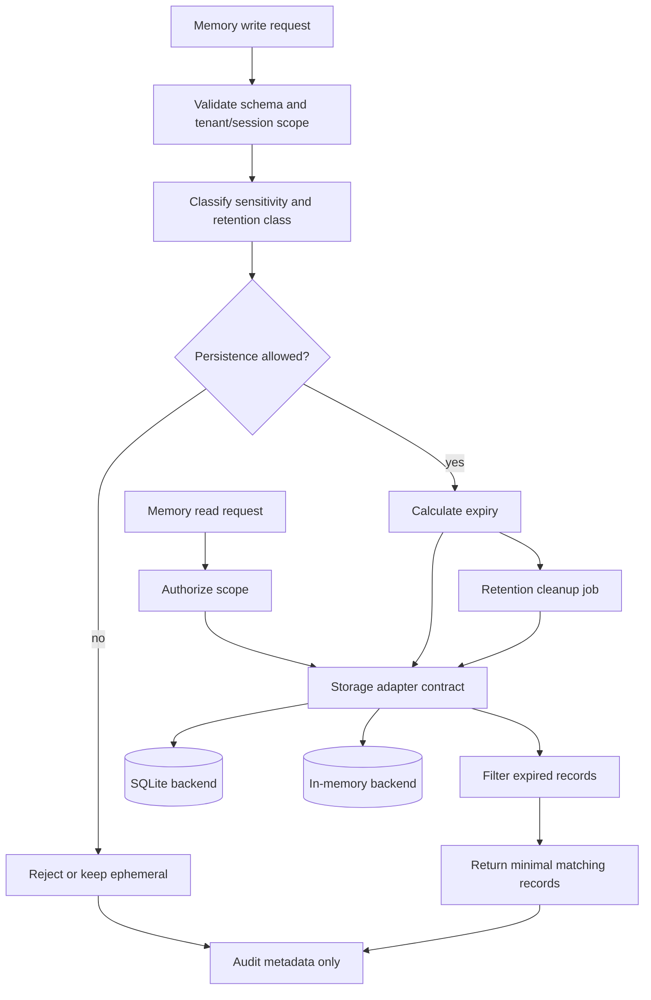

# x4-memory

**Local-first persistent multi-layer agent memory**

Working • Episodic • Semantic • Knowledge Graph • Provenance • Privacy controls

Part of **[ARIEX4Ops / X4](https://github.com/dhe-cruzer69)**.

---

## Principle

Memory must never be a mysterious black box. Every stored item carries provenance, namespace, and export/deletion support.

## Related

- [x4-agents](https://github.com/dhe-cruzer69/x4-agents)
- [x4-core](https://github.com/dhe-cruzer69/x4-core)

## License

Apache-2.0

## Support

**[GitHub Sponsors](https://github.com/sponsors/dhe-cruzer69)**

## APEX Architecture Map

> Status: architecture documentation; implementation and deployment claims require independent verification.

**Evidence note:** Retention enforcement, encryption, access scope, and cleanup scheduling are not implied by this diagram; verify them in implementation and tests.

